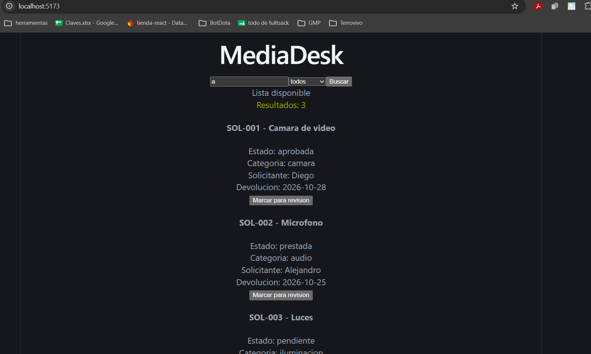
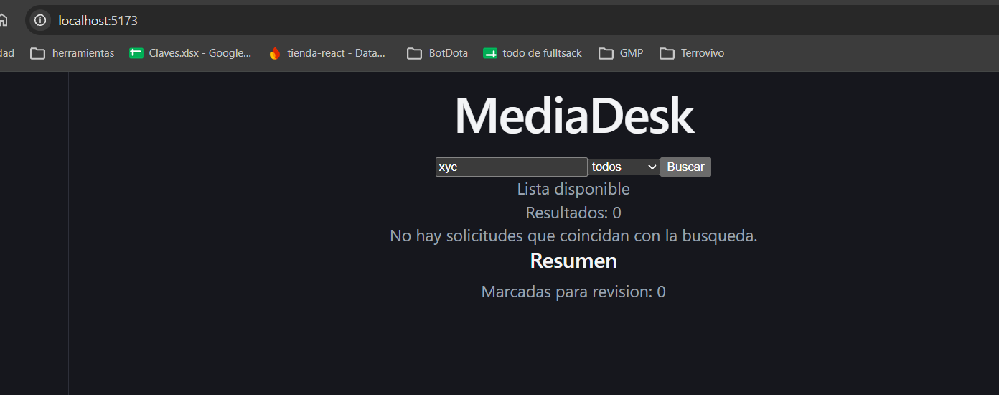
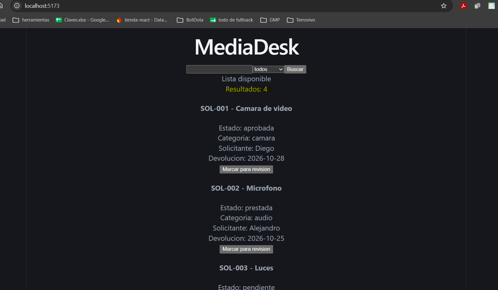
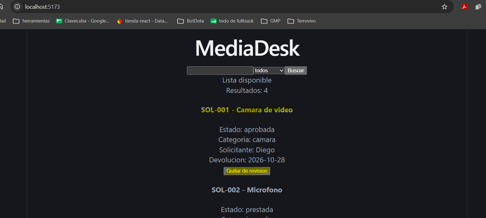
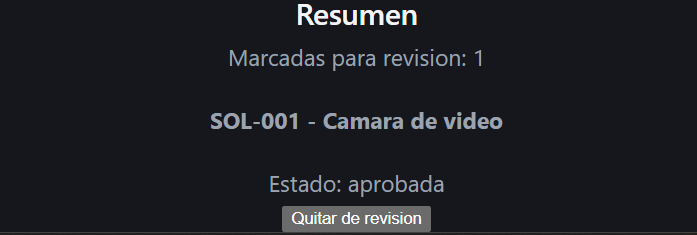

# mediadesk

## objetivo

hice una pantalla en react con typescript para buscar solicitudes de prestamo de equipo audiovisual y marcarlas para revision. los datos estan en memoria.

## requisitos previos

tener node.js 22.12 o mas nuevo y npm.

## instalacion

- npm install

## ejecucion

- npm run dev
- abrir http://localhost:5173

## revisar typescript

- npm run build

## evidencia

### 1. ejecucion (paso 1)

PS C:\Users\Camus PC\Desktop\universidad\semestre 4\Tarea2-ReactAvanzado\mediadesk>  npm run dev

> mediadesk@0.0.0 dev
> vite

  VITE v8.3.5  ready in 220 ms

  ➜  Local:   http://localhost:5173/
  ➜  Network: use --host to expose
  ➜  press h + enter to show help

### 2. chequeo de typescript (paso 11)

PS C:\Users\Camus PC\Desktop\universidad\semestre 4\Tarea2-ReactAvanzado\mediadesk> npm run build

> mediadesk@0.0.0 build
> tsc -b && vite build

vite v8.3.5 building client environment for production...
✓ 24 modules transformed.
computing gzip size...
dist/index.html                   0.45 kB │ gzip:  0.29 kB
dist/assets/index-D64VDMd1.css    4.10 kB │ gzip:  1.47 kB
dist/assets/index-Bq2bsrHc.js   222.51 kB │ gzip: 69.59 kB

✓ built in 128ms

### 3. busqueda con varios resultados (paso 9)

### 4. busqueda sin coincidencias (paso 9)

### 5. consulta vacia (paso 9)

### 6. marcar para revision (paso 8)

